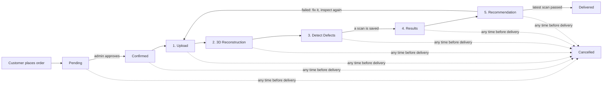
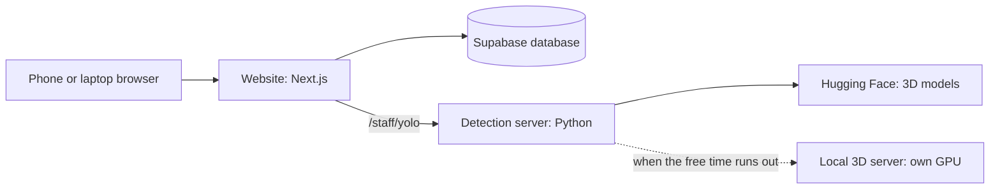

# How MFQATS works: from order to delivery

This explains what happens in the system when a customer buys a piece of furniture, who does each step, and what
the system does by itself. It describes the code as it is now (October 2026).

## The people

| Role | What they do in the system | Main screens |
|---|---|---|
| **Customer** | Browses and orders furniture, follows the order, asks questions | Shop Products, Overview, OrderView, Inquiry |
| **Staff (worker)** | Moves the order through the inspection stages and inspects the piece | Order Workflow, **Quality Scan**, Assigned Tasks, Inventory, Messages |
| **Admin (supervisor)** | Approves orders, watches progress and quality, handles rework | Admin Overview, Inspection Progress, Order Management, Rework Queue, Reports, Defect Analytics |

## The whole flow at a glance

**Pending** and **Confirmed** are order statuses. The **five inspection stages** are Upload → 3D Reconstruction →
Detect Defects → Results → Recommendation. **Delivered** and **Cancelled** are final.

---

## Step by step

### 1. The customer orders
- The customer opens **Shop Products**, adds furniture to the cart (prices in ₱) and checks out.
- The system creates the order as **Pending**. The database refuses a new order in any other status.

### 2. The admin approves it
- In **Order Management**, the admin moves the order to **Confirmed**.
- From now on, every stage change sends the customer a notification: *"Your order MVC-… is now: Confirmed"*.

### 3. Upload (stage 1)
- Staff open **Order Workflow** and move the order to **Upload**.
- On **Quality Scan**, they choose the order and take the inspection photos in step **① Upload** (front, left,
  back, right, top, bottom). The page has one step per stage, and the same photos are used by the 3D model and the
  defect scan.

### 4. 3D Reconstruction (stage 2)
In Quality Scan step **② 3D Reconstruction**, the Upload photos (front, left, back, right, top, bottom) become a
colored **3D Model** of the whole piece. On the model:

| Button | What it shows |
|---|---|
| **Dimensions** | Length, width and height lines on the model, with the sizes from the customer's order (the same as in the shop) |
| **Defect pins** | A numbered pin on the side where each defect was found by the photo scans |
| **Edit mode** | Like Blender's edit mode: the model's surface grid, with the faces where a defect was found painted red (fails the piece), amber (check) or green (natural wood) |
| **Colors / Shape** | The model with or without its colors |

The defects come from the YOLOv12 scans of the photos (step ③); the 3D model itself does not find defects, and the
pins and painted faces are at approximate spots. The model can be viewed full screen and downloaded as `.glb`.

How the 3D Model is built:
1. **Normal build**: TRELLIS (free Hugging Face service) builds the colored model from all the photos, after cutting
   out the backgrounds. About a minute, about 4 to 6 a day.
2. **When the free daily time runs out**: Hunyuan3D builds a grey shape from the four side photos, online, or on the
   laptop's own NVIDIA GPU if the local 3D server (Terminal 4) is running. The panel says when this happens.

The 3D model is for showing the piece; it is not to scale. Its sizes come from the order.

### 5. Detect Defects (stage 3)
- Staff move the order to **Detect Defects**, then scan the piece in **Quality Scan** with the **live camera** or an
  **uploaded photo**.
- **YOLOv12** finds defects (cracks, knots, scratches, dents…). It checks the whole photo, and also small tiles of it so
  thin scratches are not missed. Each defect gets a box, a confidence score, a severity and a **repair recommendation**.
- **Save Detection** stores the scan with the order: photo, defects, average confidence, and **Pass/Fail**. Fail means at
  least one defect that is not low-severity. Natural wood features like live knots are low-severity and do not fail
  the piece.

When a scan is saved, the system **automatically**:
- **Pass**: tells the admins the order's results are ready for review.
- **Fail**: creates a **rework task** listing the defects and their recommended fixes (Rework Queue), and warns the
  admins.
- Adds the real defects to **Defect Analytics** and the reports.

### 6. Results (stage 4)
- After a scan is saved, staff can press the button in Quality Scan to move the order to **Results**.
- The database **blocks** this move until a scan has been saved during the current Detect Defects stage.
- The admin reviews the findings, photos and confidence scores.

### 7. Recommendation (stage 5)
- **Passed**: the order can move to **Delivered**. The database only allows this if the order's **latest scan passed**.
- **Failed**: the workshop does the corrective work from the rework task, and the order goes **back to Upload** to be
  inspected again from the start. It can only be delivered once a new scan passes.

### 8. Delivered
- The order is closed. The customer gets the final notification.

---

## What the system does by itself

| Automatic | How |
|---|---|
| **Stage rules (FSM)** | Orders can only move one step at a time along the arrows above; skipped steps and the two checks (scan saved, scan passed) are enforced by the database, not just the screens |
| **Stage timing** | Every stage move is time-stamped, with no manual start/stop |
| **Delivery estimate (PERT)** | Expected time per stage: Te = (O + 4M + P) / 6, from the fastest, average and slowest past times (starting estimates until there is enough history) |
| **Current pace (WMA)** | Weighted average of the most recent stage times, newest weighted most, to show if work is running faster or slower than the estimate |
| **Customer notifications** | A message on every stage change |
| **Rework and admin alerts** | Created from failed or passed scans |
| **Completion %** | Updated with every stage move |

The customer's **OrderView** shows the stage timeline and the PERT estimated completion date.

## What the admin sees

| Screen | Shows |
|---|---|
| **Admin Overview** | Revenue in ₱ (hidden until the eye icon is clicked), orders in progress, staff, **defect rate** (failed ÷ inspected), revenue per month, recent orders, alerts, low stock |
| **Inspection Progress** | Orders in inspection, average time per stage, inspection pass rate, bottlenecks (stages where an order is past its PERT time), stage timeline |
| **Rework Queue** | Rework tasks from failed scans, with the recommended fixes |
| **Defect Analytics / Reports** | Defects by type and severity, confidence scores, CSV exports |

## Behind the scenes

- **Website** (Next.js): all screens for the three roles. Phones reach it through the https tunnel.
- **Supabase**: the database, logins and the automatic rules above.
- **Detection server** (Python, FastAPI): YOLOv12 detection and the 3D Model.
- **Hugging Face**: the free online 3D model services (TRELLIS, Hunyuan3D), about 5 minutes of GPU time a day.
- **Local 3D server** (optional): Hunyuan3D on an NVIDIA GPU with 4 GB+ memory, no daily limit.

How to start everything: [DEVICE_TESTING.md](../setup/DEVICE_TESTING.md).

## Not connected yet

- The customer's **Photo Gallery** reads inspection photos from a table the Quality Scan does not write to yet, so it
  only shows photos added there directly. The scan photo itself is saved with each scan.
- **3D models** are shown and downloaded, but not saved with the order.
